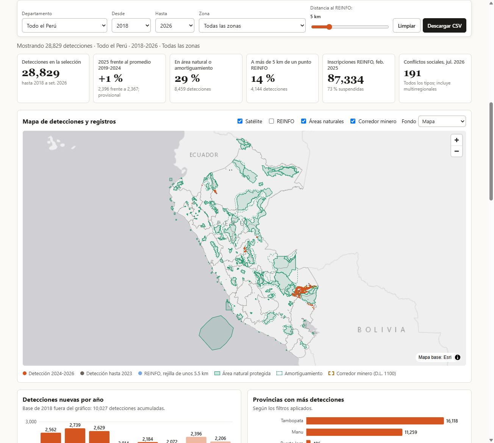
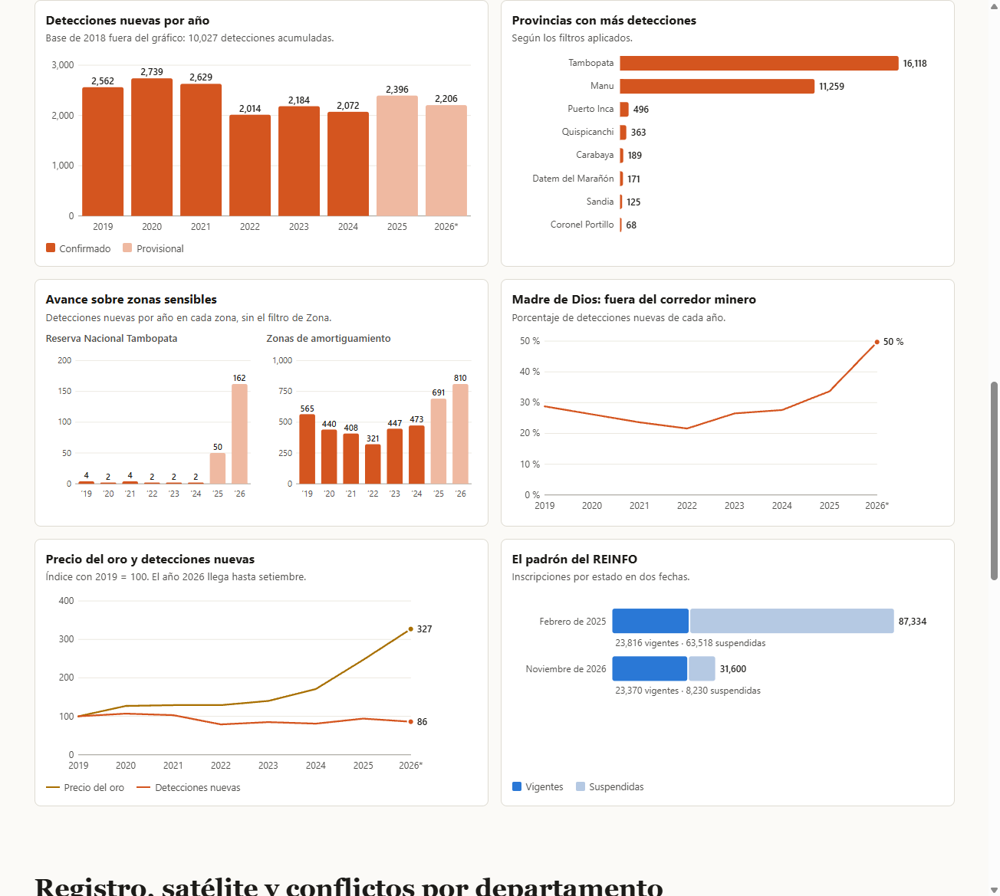

# Minería informal en el Perú: lo que registra el Estado y lo que ve el satélite

**Tarea 3 · Python intermedio · QLAB PUCP · Eliana Camacho**

- **Dashboard:** https://ecamachoro-bit.github.io/python-intermedio/tarea_3/web/
- **Publicación de LinkedIn:** https://lnkd.in/p/efdvRAir
- **Reel:** [`reel/reel.mp4`](reel/reel.mp4)





## 1. Tema y pregunta de investigación

**¿Dónde se expande la minería informal de oro en la Amazonía peruana y coincide esa expansión con lo que registra el Estado?**

Cobertura: Perú, de 2018 a setiembre de 2026. Las detecciones satelitales solo cubren la cuenca amazónica.

## 2. Descripción

El proyecto cruza el Registro Integral de Formalización Minera (REINFO) con cicatrices de minería detectadas por satélite, áreas naturales protegidas, el corredor minero de Madre de Dios, el precio del oro y los conflictos sociales. El resultado es un dashboard público con filtros, mapa y gráficos, y un reel de divulgación narrado con mi voz clonada.

## 3. Fuentes y metodología

| Fuente | Qué aporta | Corte |
|---|---|---|
| [Amazon Mining Watch](https://source.coop/earthgenome/amazon-mining-watch) (CC BY 4.0) | 28,829 detecciones en Perú sobre imágenes Sentinel-2 | 16 oct 2026 (datos hasta el 3.er trimestre de 2026) |
| [REINFO en GEOCATMIN](https://geocatmin.ingemmet.gob.pe/arcgis/rest/services/SERV_REINFO/MapServer) | 87,334 inscripciones con coordenadas | 26 feb 2025 |
| [Padrón público del REINFO](https://pad.minem.gob.pe/REINFO_WEB/Index.aspx) | Total actual: 31,600 inscripciones | 1 nov 2026 |
| [Áreas reservadas](https://geocatmin.ingemmet.gob.pe/arcgis/rest/services/SERV_AREA_RESERVADA/MapServer) y [catastro de Madre de Dios](https://geocatmin.ingemmet.gob.pe/arcgis/rest/services/SERV_CATASTRO_MADRE_DIOS/MapServer) | Áreas naturales, amortiguamiento, reservas y corredor minero (D.L. 1100) | Consulta del 1 nov 2026 |
| [Demarcación en GEOCATMIN](https://geocatmin.ingemmet.gob.pe/arcgis/rest/services/SERV_CARTOGRAFIA_DEMARCACION_WGS84/MapServer) | Límites de departamentos y provincias | Consulta del 1 nov 2026 |
| [Banco Mundial, Pink Sheet](https://www.worldbank.org/en/research/commodity-markets) | Precio mensual del oro | 2 oct 2026 |
| [Defensoría del Pueblo, reporte n.° 269](https://www.defensoria.gob.pe/wp-content/uploads/2026/08/Reporte-de-Conflictos-Sociales-n-269.pdf) | Conflictos por región y conflictos mineros | Julio de 2026 |

**Procesamiento:**

1. Se filtran las detecciones dentro del Perú, se revisan duplicados (0) y se asignan a provincia con límites oficiales.
2. Se marcan las detecciones dentro de áreas naturales (sin áreas privadas ni municipales), amortiguamiento, reservas indígenas y corredor minero.
3. Del REINFO se descargan solo campos no personales. El 99.6 % de las coordenadas coincide con el departamento declarado; el cruce espacial usa solo esas.
4. Se mide la distancia de cada detección al punto del REINFO más cercano.
5. El dashboard muestra el REINFO en una rejilla de unos 5.5 km, sin puntos individuales.

## 4. Hallazgos principales

1. **El ritmo se mantiene, pero aparece un nuevo frente.** Las detecciones de 2025 (2,396) están cerca del promedio de 2019-2024 (2,367). Madre de Dios concentra el 95 %, pero Puerto Inca (Huánuco) pasó de 65 detecciones hasta 2023 a 431 nuevas entre 2024 y setiembre de 2026. [MAAP #233](https://aidesep.org.pe/wp-content/uploads/2025/09/MAAP-233.-Situacion-actual-de-Mineria-de-Oro-en-1.pdf) coincide en el orden general: Madre de Dios tiene el 97.5 % de la deforestación minera y Huánuco es la siguiente región.
2. **Avanza hacia zonas más sensibles.** En la Reserva Nacional Tambopata hubo 16 detecciones nuevas entre 2019 y 2024, y 212 desde 2025. En Madre de Dios, la parte fuera del corredor minero subió de 28 % en 2024 a 50 % en 2026. [MAAP #241](https://www.maapprogram.org/mining-peru-tambopata/) reporta 500 hectáreas deforestadas por minería ilegal en esa reserva entre 2025 y febrero de 2026.
3. **El padrón se reduce y las cicatrices no se detienen.** El REINFO bajó de 87,334 inscripciones (febrero de 2025) a 31,600 (noviembre de 2026), mientras se detectaron 2,396 parches en 2025 y 2,206 hasta setiembre de 2026. El oro se multiplicó por 2.3 entre 2023 y 2026 sin un aumento proporcional de las detecciones.

## 5. Limitaciones

- **Una detección no prueba ilegalidad.** Es una señal de minería en un parche de 480 × 480 m y no equivale a hectáreas minadas.
- **Cobertura parcial.** El modelo apunta a la minería artesanal de oro a cielo abierto en la Amazonía. Un cero no significa ausencia de minería. Por ejemplo, Apurímac tiene 5,942 inscripciones y 0 detecciones, pero solo cerca del 12 % de su territorio cae dentro del límite de cuenca publicado por el proyecto.
- **Datos provisionales.** 2025 y 2026 usan otro criterio de confirmación y 2026 llega hasta setiembre. Los primeros trimestres registran menos detecciones.
- **2018 es un acumulado**, no un año de expansión.
- **REINFO.** Incluye todos los minerales y coordenadas declaradas. La capa geográfica es anterior a la depuración de 2025. Estar cerca de un punto no implica autorización. El resultado cambia con la distancia: a más de 1 km está el 35 % de las detecciones, a más de 5 km el 14 % y a más de 10 km el 9 %.
- **Conflictos.** El cuadro por región incluye todos los tipos y sirve solo como contexto.
- **Oro.** La comparación usa pocos años y no permite afirmar causalidad.

## 6. Cómo reproducir

```bash
cd tarea_3
pip install -r requirements.txt
python scripts/obtener_datos.py        # descarga las fuentes en datos/originales/
python scripts/reinfo_web_totales.py   # totales actuales del padrón público
python scripts/procesar_datos.py       # limpieza y cruces, en datos/procesados/
python scripts/analizar_datos.py       # indicadores y pruebas de sensibilidad
python scripts/preparar_web.py         # datos del dashboard, en web/data/
python -m http.server 8000 --directory web
```

Luego se abre http://localhost:8000. Los archivos originales pesados no se suben al repositorio, porque el primer script los vuelve a descargar. Los servicios públicos pueden cambiar sus datos con el tiempo. El reel se documenta en [`reel/`](reel/).

## 7. Datos personales

El REINFO público incluye nombres y RUC. Este proyecto no los descarga, no los procesa y no los publica. Tampoco se sube la grabación original de mi voz.

## 8. Uso de inteligencia artificial

Usé Claude Code para buscar fuentes, escribir el código, construir el dashboard y redactar el guion. La narración del reel se generó con Qwen3-TTS a partir de mi propia voz. Las cifras se calcularon con los scripts de este repositorio y se contrastaron con las fuentes citadas.

El visor de mapas usa [MapLibre GL JS](https://maplibre.org/) (BSD-3-Clause).
