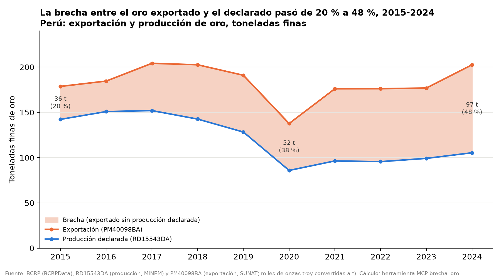
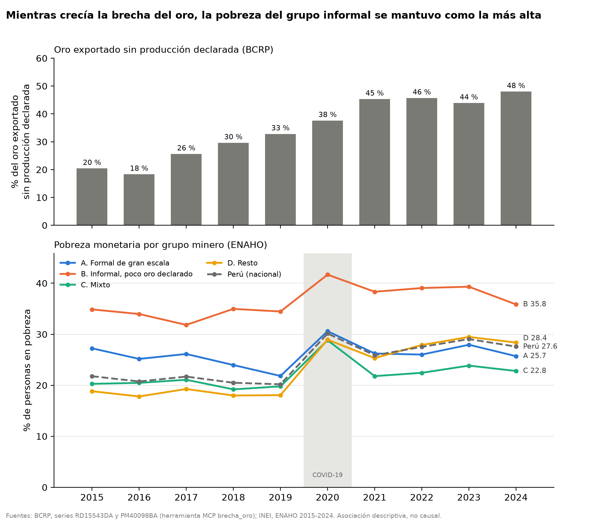
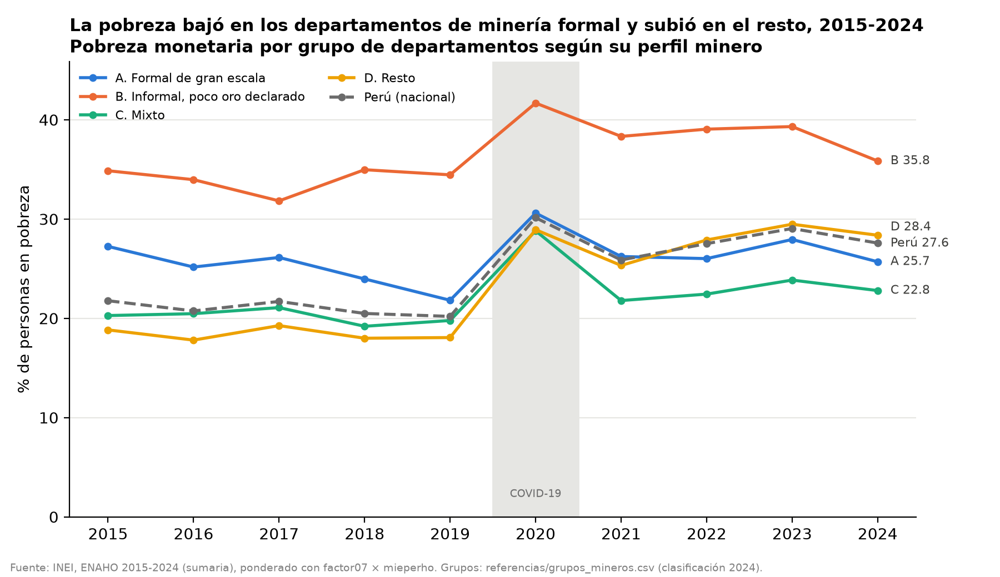
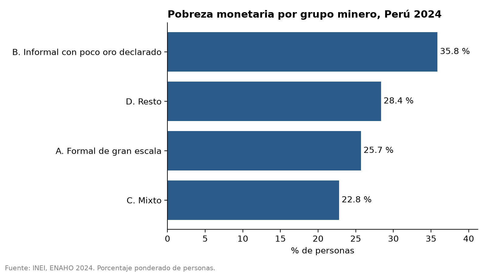
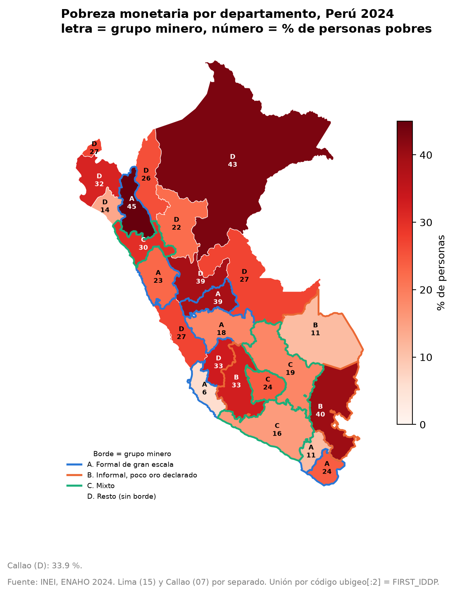

# Pobreza monetaria y minería en el Perú, 2015-2024: departamentos con minería formal de gran escala frente a departamentos con minería informal de oro

## 1. Pregunta de investigación

**Tema.** La relación entre el tipo de minería que predomina en un departamento y la pobreza monetaria de su población, en un periodo en que el oro que el Perú exporta se aleja cada vez más del oro que declara producir.

**Pregunta.** Entre 2015 y 2024, ¿cómo difirió la pobreza monetaria entre los departamentos con minería formal de gran escala y aquellos con alta ocupación minera informal y baja producción de oro declarada, en un contexto de brecha creciente entre exportación y producción de oro?

**Objetivo.** Describir y comparar la evolución de la pobreza monetaria (porcentaje de personas pobres, ENAHO) por grupo minero de departamentos, y ponerla junto a la brecha exportación–producción de oro del BCRP y a la producción de oro declarada por departamento.

**Delimitación.** Son los 25 departamentos del Perú (Lima y Callao por separado), entre 2015 y 2024, con datos anuales. El análisis es descriptivo y no establece causalidad.

**Grupos mineros** (`referencias/grupos_mineros.csv`, unidos por código `ccdd`; la clasificación es fija y se basa sobre todo en la ENAHO 2024, el REINFO y el MINEM):

| Grupo | Nombre | Departamentos | Criterio resumido |
|---|---|---|---|
| A | Formal de gran escala | Áncash, Cajamarca, Ica, Junín, Moquegua, Pasco, Tacna | Grandes operaciones formales (Antamina, Yanacocha, Marcona, Toromocho, Quellaveco/Cuajone, Toquepala) con baja informalidad minera en la ENAHO 2024 |
| B | Informal con poco oro declarado | Ayacucho, Madre de Dios, Puno | Alta proporción del empleo en minería y mayoría informal (64 %, 89 % y 55 % según la ENAHO 2024), mucho REINFO y poca gran minería |
| C | Mixto | Apurímac, Arequipa, Cusco, La Libertad | Gran minería formal junto con una informalidad minera alta (41 %-55 %) |
| D | Resto | Los 11 departamentos restantes | Sin minería relevante o con minería formal mediana o pequeña (incluye Lima y Huancavelica por decisión del estudio) |

La comparación central es **A frente a B**. C y D sirven de contraste.

## 2. Fuentes y metodología

**BCRP (servidor MCP `bcrp`).** Consulté las series en `buscar_series` y luego las bajé con las herramientas `brecha_oro`, `oro_por_departamento` y `comparar_periodos`:

- `RD15543DA`: producción de oro, total nacional (gramos finos, fuente MINEM), anual.
- `PM40098BA`: volumen exportado de oro, anual. La herramienta advierte que, aunque la etiqueta dice «millones de onzas troy», los valores son miles de onzas troy.
- `RD15544DA` … `RD15560DA`: producción de oro por departamento (17 series, gramos finos, MINEM).
- La brecha se define así: `brecha_t = exportación − producción` y `brecha_pct = brecha / exportación × 100`.
- Archivos guardados tal cual los devolvió la herramienta: `salidas/brecha_oro_2015_2024.json` y `salidas/oro_por_departamento_2015_2024.json`.

**ENAHO del INEI (skills `limpiando-enaho`, `graficando-enaho` y `mapeando-enaho`).**

- **Módulo 34 (sumaria)**, de 2015 a 2024 (códigos INEI 498, 546, 603, 634, 687, 737, 759, 784, 906 y 966). Da la pobreza monetaria (`pobreza`) del hogar.
- **Módulo 02 (miembros del hogar)**, 2024. Base de personas (residentes habituales) con `facpob07`.
- **Módulo 05 (empleo)**, 2024. Ocupados en minería (CIIU) y su informalidad.
- **Ponderación.** Para pobreza por departamento y grupo uso `factor07 × mieperho` (método INEI). Para la base de personas uso `facpob07`. Nunca uso promedios sin ponderar.
- **Validación 2024** (`salidas/validacion.txt`). Todas las verificaciones dan `[PASA]`. La pobreza nacional ponderada es 27.58 %, frente a la cifra oficial del INEI de 27.6 %. Hay 108,664 residentes habituales y la unión persona–hogar no pierde ni duplica registros. Los años 2015-2023 también pasan su validación (`salidas/validacion_<año>.txt`).
- **Proxy de informalidad.** Es el porcentaje de ocupados en minería con empleo informal según la ENAHO 2024 (`pct_informal_en_mineria`, `salidas/empleo_minero_2024.csv`). La columna `confiable` marca los departamentos con al menos 30 mineros en la muestra. La ENAHO no mide directamente la minería ilegal. La brecha del oro del BCRP es un indicador indirecto, de nivel nacional, del oro sin producción registrada.

## 3. Resultados

**Hallazgo 1. La brecha entre el oro exportado y el oro producido se amplió con fuerza.**
- En 2015 la brecha fue de 36.4 t (20.4 % del oro exportado). En 2024 llegó a 97.2 t (48.0 %). El promedio 2015-2024 es de 63.2 t (34.7 %). Fuente: BCRP, `RD15543DA` y `PM40098BA`, 2015-2024, en `salidas/brecha_oro_2015_2024.json`.
- La producción declarada bajó de 142.3 t (2015) a 105.4 t (2024). La exportación fue de 178.7 t en 2015 y de 202.6 t en 2024. Fuente: el mismo archivo.
- La producción promedio de oro (`RD15543DA`) cayó de 143,226,304 g finos por año en 2015-2019 a 96,512,539 g finos por año en 2020-2024, una variación de −32.6 %. Fuente: BCRP, herramienta `comparar_periodos`, `RD15543DA`, 2015-2019 frente a 2020-2024.

**Hallazgo 2. El grupo B, informal con poco oro declarado, tuvo la pobreza más alta en todos los años y no se redujo. El grupo A, formal de gran escala, terminó el periodo algo por debajo de su nivel de 2015.**
- **Grupo B.** La pobreza fue de 34.9 % en 2015, 34.5 % en 2019, 41.7 % en 2020 y 35.8 % en 2024. El cambio 2015-2024 es de +1.0 pp (`salidas/indicadores_grupo.csv` y salida de `serie_pobreza.py`). *Nota de revisión: en la ejecución del agente `serie_pobreza.py` redondeaba antes de restar y mostraba +0.9; se corrigió para restar sin redondear, y la verificación independiente da +0.98 pp (`evaluacion/verificacion_independiente.txt`).* Fuente: INEI, ENAHO 2015-2024, en `salidas/pobreza_grupo_minero_2015_2024.csv` y `salidas/indicadores_grupo.csv`.
- **Grupo A.** La pobreza fue de 27.2 % en 2015, 21.8 % en 2019, 30.6 % en 2020 y 25.7 % en 2024, un cambio de −1.5 pp. Fuente: las mismas.
- **Contraste.** En el mismo lapso la pobreza nacional subió de 21.8 % a 27.6 % (+5.8 pp). El grupo D subió de 18.8 % a 28.4 % (+9.5 pp) y el grupo C de 20.3 % a 22.8 % (+2.5 pp). Fuente: las mismas.
- **Año 2024.** El orden fue C 22.8 %, A 25.7 %, D 28.4 % y B 35.8 %. Fuente: INEI, ENAHO 2024, salida de `graficar.py --por grupo_minero`.

**Hallazgo 3. Los departamentos del grupo B concentran el empleo minero informal, pero declaran poco oro y cada vez menos.**
- **Peso del empleo minero.** La minería es el 3.3 % del empleo en el grupo B y el 1.6 % en el grupo A. Fuente: INEI, ENAHO 2024, módulo 05, en `salidas/indicadores_grupo.csv`.
- **Informalidad minera.** Es de 62.6 % en el grupo B y de 13.7 % en el grupo A. Fuente: la misma.
- **Oro declarado por grupo.** El grupo B aportó el 16.5 % del oro declarado en 2015-2024 (197.5 t), y su producción cayó de 22.8 t (2015) a 12.3 t (2024). El grupo A aportó el 29.2 % (349.7 t) y bajó de 52.2 t a 24.2 t. El grupo C aportó el 50.0 % (598.8 t). Fuente: BCRP, `RD15544DA`-`RD15560DA`, 2015-2024, combinado en `salidas/indicadores_grupo.csv`.
- **Madre de Dios.** El 6.1 % del empleo es minero y el 89.3 % de él es informal (n = 57 mineros). Su oro declarado cayó de 8.62 t (2015) a 1.09 t (2024), un −87.4 %. Fuente: ENAHO 2024, `salidas/empleo_minero_2024.csv`; BCRP `RD15556DA` en `salidas/oro_por_departamento_2015_2024.json`.
- **Puno.** El 3.0 % del empleo es minero y el 55.2 % de él es informal (n = 36). Su oro declarado bajó de 4.79 t a 2.92 t (−39.0 %). Fuente: las mismas, `RD15559DA`.
- **Ayacucho.** El 3.1 % del empleo es minero y el 63.6 % de él es informal, pero con n = 28 la muestra no es confiable. Su oro declarado bajó de 9.38 t a 8.32 t (−11.2 %). Fuente: las mismas, `RD15547DA`.

**Hallazgo 4. Dentro de cada grupo hay mucha heterogeneidad, así que el promedio de grupo oculta trayectorias opuestas.**
- **Grupo B.** Puno pasó de 34.6 % (2015) a 39.9 % (2024), con +5.3 pp. Madre de Dios pasó de 7.1 % a 11.1 % (+4.0 pp). Ayacucho bajó de 40.7 % a 32.8 % (−8.0 pp). Fuente: INEI, ENAHO 2015 y 2024, en `salidas/indicadores.csv`.
- **Grupo A.** En 2024 conviven departamentos de pobreza muy baja, como Ica (6.01 %) y Moquegua (10.97 %), con otros entre los más pobres del país, como Cajamarca (45.01 %) y Pasco (38.97 %). Cajamarca fue el departamento con más pobreza en 2024 y Puno (grupo B) el tercero. Fuente: INEI, ENAHO 2024, en `salidas/indicadores.csv` y en la salida de `mapear.py`. El mapa coincide 25/25 con la referencia de la Sesión 16 (`salidas/comparacion_mapa_referencia.csv`).

## 4. Visualizaciones

*Figura 1. Producción (`RD15543DA`) y exportación (`PM40098BA`) de oro, en toneladas, 2015-2024. Fuente: BCRP.*

*Figura 2. Arriba, la brecha exportación–producción de oro (BCRP). Abajo, la pobreza monetaria por grupo minero (INEI, ENAHO 2015-2024). Los dos paneles están separados y cada uno tiene su propio eje.*

*Figura 3. Evolución de la pobreza monetaria (% de personas) por grupo minero y para el Perú, 2015-2024. Fuente: INEI, ENAHO.*

*Figura 4. Pobreza monetaria por grupo minero en 2024. Fuente: INEI, ENAHO 2024.*

*Figura 5. Pobreza monetaria por departamento en 2024, con el borde y la letra del grupo minero. Fuente: INEI, ENAHO 2024.*

## 5. Interpretación

La respuesta a la pregunta tiene tres partes:

- **Nivel.** Los departamentos con alta ocupación minera informal y poco oro declarado (grupo B) tuvieron una pobreza monetaria mayor que los de minería formal de gran escala (grupo A) en cada año de 2015 a 2024: 34.9 % frente a 27.2 % en 2015 y 35.8 % frente a 25.7 % en 2024 (`salidas/pobreza_grupo_minero_2015_2024.csv`). La distancia entre ambos grupos fue mayor al final del periodo que al inicio.
- **Tendencia.** Ninguno de los dos grupos siguió el fuerte aumento de la pobreza nacional y del grupo D después de 2020. El grupo A volvió a un nivel algo menor que el de 2015. El grupo B se mantuvo alto y estancado. Su pico de 2020 fue el mayor de todos los grupos.
- **Contexto del oro.** La brecha exportación–producción pasó de 20.4 % a 48.0 % del oro exportado. Al mismo tiempo, el oro declarado por los departamentos del grupo B se redujo casi a la mitad (de 22.8 t a 12.3 t). Esto es compatible con la hipótesis de que una parte creciente de la actividad aurífera de estos departamentos no queda registrada como producción, pero los datos no permiten comprobarla: la brecha es nacional y no se puede asignar a departamentos. Lo que sí se observa es que, mientras crecía la brecha, la pobreza del grupo B no bajó y siguió siendo la más alta; no se puede afirmar que una cosa explique la otra.

Sin embargo, la heterogeneidad interna obliga a matizar. Madre de Dios, el caso más «informal», tiene una pobreza baja (11.1 % en 2024). Cajamarca, emblema de la gran minería formal de oro, es el departamento más pobre. Los grupos describen perfiles mineros, no mecanismos.

## 6. Limitaciones

- **Asociación, no causalidad.** Las diferencias entre grupos reflejan también ruralidad, estructura productiva, acceso a servicios y otros factores que no se controlan.
- **Clasificación fija en 2024.** Los grupos A/B/C/D se definieron con información de la ENAHO 2024 y del REINFO actual, y se aplican hacia atrás a 2015-2023. Un departamento pudo tener otro perfil minero al inicio del periodo.
- **El grupo B no es homogéneo en el oro declarado.** Madre de Dios (−87.4 %) y Puno (−39.0 %) cumplen el criterio de «baja producción declarada», pero Ayacucho aportó el 8.4 % del oro declarado del país en 2015-2024 (`salidas/oro_por_departamento_2015_2024.json`), más que cualquier departamento del grupo A salvo Cajamarca. Ayacucho entra en B por su alta informalidad minera en la ENAHO, no por producir poco oro. Además, por su población, Puno pesa mucho en la tasa del grupo B.
- **Fuentes secundarias del REINFO.** Las cifras del REINFO que se citan en el criterio de los grupos provienen de `referencias/mineria_formal_informal_departamentos.xlsx`, una compilación secundaria, no de una consulta directa al registro oficial.
- **Muestras pequeñas de mineros.** En la ENAHO 2024 varios departamentos tienen menos de 30 mineros en la muestra (por ejemplo, Ayacucho n = 28, Apurímac n = 13, Cusco n = 17, Cajamarca n = 23), y por eso `confiable = False`. Los porcentajes de informalidad minera son imprecisos.
- **Campamentos mineros.** La ENAHO encuesta viviendas particulares, así que los trabajadores en campamentos de la gran minería (por ejemplo, Antamina en Áncash) quedan subrepresentados. Esto subestima el empleo minero del grupo A.
- **La brecha del oro es un indicador indirecto.** La diferencia exportación–producción no mide directamente el oro ilegal o informal. Puede incluir variaciones de inventarios, oro reexportado o diferencias de registro. Además, la etiqueta de la serie `PM40098BA` tiene un error de unidad, que la herramienta corrige.
- **Distintos niveles de agregación.** La brecha del oro es nacional y no se puede asignar a departamentos. La pobreza y el empleo son departamentales. Ponerlos juntos es contextual: no correlaciona la brecha con la pobreza de cada departamento.
- **Rupturas en la serie.** El año 2020 (pandemia) tuvo un trabajo de campo atípico en la ENAHO. Las cifras de pobreza por grupo son promedios ponderados por población, así que dentro de cada grupo pesan más los departamentos más poblados.

## 7. Reproducibilidad

- **Datos.** Están en `datos/`: los zip de la ENAHO (`<código>-Modulo34.zip` de 2015 a 2024; `966-Modulo02.zip` y `966-Modulo05.zip`) y `peru_departamental_simple.geojson`.
- **BCRP.** Se consultó con el servidor MCP `bcrp` (`mcp/`), en las series `RD15543DA`, `PM40098BA` y `RD15544DA`-`RD15560DA`. Las salidas son `salidas/brecha_oro_2015_2024.json` y `salidas/oro_por_departamento_2015_2024.json`. `scripts/consultar_bcrp.py` las regenera.
- **Limpieza ENAHO.** El script `.claude/skills/limpiando-enaho/scripts/limpiar.py` se corre con `--anio 2024`, y con `--solo-sumaria` para los demás años. Luego se corren `serie_pobreza.py` y `empleo_minero.py`. Salidas: `salidas/hogares_<año>.parquet`, `salidas/personas_2024.parquet`, `salidas/validacion*.txt`, `salidas/pobreza_departamento_2015_2024.csv`, `salidas/pobreza_grupo_minero_2015_2024.csv` y `salidas/empleo_minero_2024.csv`.
- **Gráficos.** `.claude/skills/graficando-enaho/scripts/graficar.py --por grupo_minero`, `serie_grupos.py --brecha salidas/brecha_oro_2015_2024.json` y `scripts/graficar_oro_bcrp.py` generan las salidas en `figuras/`.
- **Mapa.** `.claude/skills/mapeando-enaho/scripts/mapear.py --marcar-grupos` genera el archivo en `mapas/`.
- **Tabla integrada.** `scripts/indicadores.py` genera `salidas/indicadores.csv` y `salidas/indicadores_grupo.csv`.
- **Todo de una vez.** `bash reproducir.sh` corre las pruebas del MCP, la limpieza de los 10 años, la serie, el empleo, la consulta BCRP, las figuras, los mapas y los indicadores.

En esta ejecución volví a correr la validación 2024, la serie 2015-2024, el empleo minero, los gráficos, el mapa, el gráfico BCRP y los indicadores. Las cifras reproducidas coinciden con las que se citan arriba. Ninguna herramienta falló.

## 8. Verificación de cifras

Cinco afirmaciones del informe se recalcularon por un camino independiente, sin las Skills ni el MCP
(`evaluacion/verificar_cifras.py`: ENAHO leída con `pyreadstat` desde los zip originales; BCRP pedido a la API de
BCRPData con `urllib`). Salida: `evaluacion/verificacion_independiente.txt`.

| Afirmación del informe | Valor del informe | Valor recalculado | Fuente / procedimiento | ¿Coincide? |
|---|---|---|---|---|
| Brecha del oro 2015 | 36.4 t (20.4 %) | 36.4 t (20.4 %) | API BCRP RD15543DA y PM40098BA, conversión 31.1034768 g/oz | Sí |
| Brecha del oro 2024 | 97.2 t (48.0 %) | 97.2 t (48.0 %) | Ídem | Sí |
| Oro de Madre de Dios 2015→2024 | 8.62 → 1.09 t (−87.4 %) | 8.62 → 1.09 t (−87.4 %) | API BCRP RD15556DA | Sí |
| Pobreza grupo A 2015 / 2024 | 27.2 % / 25.7 % (−1.5 pp) | 27.24 / 25.70 (−1.55 pp) | Sumaria 2015 y 2024, `factor07 × mieperho`, grupos de `grupos_mineros.csv` | Sí |
| Pobreza grupo B 2015 / 2024 | 34.9 % / 35.8 % (+1.0 pp) | 34.86 / 35.85 (+0.98 pp) | Ídem | Sí (antes de la corrección, una salida mostraba +0.9 por redondear antes de restar) |
| Pobreza nacional 2024 | 27.58 % | 27.58 % | Sumaria 2024; INEI oficial 27.6 % | Sí |

Diferencias observadas: solo de redondeo (0.1 pp), ya corregidas en el script. Ninguna herramienta falló durante la
ejecución; si una serie del BCRP no tiene datos, el servidor devuelve un `ToolError` explícito en lugar de estimar.
